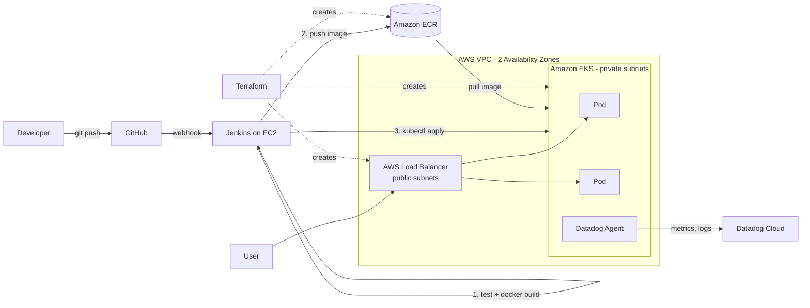

# Cloud-Native DevOps Platform on AWS

An end-to-end DevOps platform on AWS: the infrastructure is created with **Terraform**, every code push is built and deployed by **Jenkins**, the app runs as **Docker** containers on **Kubernetes (Amazon EKS)**, and everything is monitored with **Datadog**.

    

---

## Architecture



**Flow in one line:** Developer pushes code → GitHub webhook triggers Jenkins → Jenkins tests, builds the Docker image and pushes it to ECR → Jenkins deploys it to EKS with a rolling update → Datadog monitors the pods.

---

## Tech stack

| Layer | Tool | Why |
|---|---|---|
| Infrastructure as Code | Terraform | Repeatable, version-controlled infrastructure |
| Network | AWS VPC (2 AZs, public + private subnets, NAT) | High availability, nodes not exposed to the internet |
| Container registry | Amazon ECR | Private image storage with vulnerability scanning |
| Orchestration | Amazon EKS (managed node group) | Self-healing, scaling, rolling updates |
| CI/CD | Jenkins + GitHub webhook | Automatic build and deploy on every push |
| Containers | Docker | Same image runs everywhere |
| Monitoring | Datadog (Helm) | Metrics, logs, dashboards and alerts |
| App | Python Flask + Gunicorn | Simple demo app with a health endpoint |

---

## Project structure

```
.
├── app/                    # Flask app, unit tests, Dockerfile
├── terraform/              # VPC, EKS cluster, ECR repository
│   ├── versions.tf         # Terraform + AWS provider, remote state (optional)
│   ├── variables.tf
│   ├── vpc.tf              # VPC, subnets, NAT gateway
│   ├── eks.tf              # EKS cluster + worker nodes
│   ├── ecr.tf              # Image registry + cleanup policy
│   └── outputs.tf
├── k8s/                    # Kubernetes manifests
│   ├── namespace.yaml
│   ├── configmap.yaml
│   ├── deployment.yaml     # probes, resource limits, rolling update
│   ├── service.yaml        # LoadBalancer
│   └── hpa.yaml            # auto-scaling on CPU
├── monitoring/
│   └── datadog-values.yaml # Datadog Agent Helm config
├── scripts/
│   ├── bootstrap-cluster.sh  # metrics-server + Datadog
│   └── destroy.sh            # clean teardown
├── Jenkinsfile             # CI/CD pipeline
└── docs/interview-guide.md
```

---

## How to run it

### Prerequisites
AWS account, AWS CLI v2 (configured), Terraform ≥ 1.5, kubectl, Helm, Docker, a Datadog account (free trial works).

### 1. Create the infrastructure
```bash
cd terraform
cp terraform.tfvars.example terraform.tfvars
terraform init
terraform plan
terraform apply          # ~15 minutes (EKS takes time)
```
Note the outputs: `ecr_repository_url` and `configure_kubectl`.

### 2. Bootstrap the cluster (metrics-server + Datadog)
```bash
export DD_API_KEY=<your-datadog-api-key>
./scripts/bootstrap-cluster.sh
```

### 3. Set up Jenkins
1. Launch an EC2 instance (t3.medium) and install Jenkins, Docker, AWS CLI v2, kubectl, python3-venv.
2. Attach an IAM role with ECR push access (`AmazonEC2ContainerRegistryPowerUser`) and `eks:DescribeCluster`.
3. Give that role cluster access: set `jenkins_role_arn` in `terraform.tfvars` and run `terraform apply` again.
4. Add the `jenkins` user to the `docker` group and restart Jenkins.
5. Create a **Pipeline** job → *Pipeline script from SCM* → this repo → `Jenkinsfile`. Tick **GitHub hook trigger for GITScm polling**.
6. In GitHub: *Settings → Webhooks → Add* → `http://<jenkins-ip>:8080/github-webhook/`, content type `application/json`.

### 4. Deploy
Push any change to GitHub. Jenkins runs automatically. Then:
```bash
kubectl get pods,svc -n devops-app
curl http://<EXTERNAL-IP-of-service>/
```

### 5. Clean up (important: EKS + NAT cost money every hour)
```bash
./scripts/destroy.sh
```

---

## Pipeline stages

| Stage | What happens |
|---|---|
| Checkout | Pulls the latest code from GitHub |
| Unit Tests | Runs `pytest`; a failing test stops the pipeline |
| Build Docker Image | Tags the image with `<build-number>-<git-sha>` so every image is traceable |
| Push to ECR | Logs in to ECR with the EC2 IAM role (no stored keys) and pushes |
| Deploy to EKS | Applies manifests and injects the new image tag |
| Verify Rollout | Waits for healthy pods; **automatically rolls back** if the rollout fails |

---

## Key design decisions

- **Private subnets for nodes:** worker nodes have no public IPs; only the load balancer is public.
- **IAM roles, not access keys:** Jenkins uses its EC2 instance role to reach ECR and EKS.
- **Zero-downtime deploys:** `maxUnavailable: 0` plus readiness probes means old pods are only removed once new ones are ready.
- **Self-healing:** liveness probes restart stuck containers; the managed node group replaces failed nodes.
- **Auto-scaling at two levels:** the HPA scales pods on CPU, and the node group can scale from 1 to 3 nodes.
- **Cost control:** single NAT gateway, ECR lifecycle policy (keeps the last 10 images), one-command teardown.

---

## Interview guide
See [docs/interview-guide.md](docs/interview-guide.md) for a 60-second explanation and common interview questions with answers.
